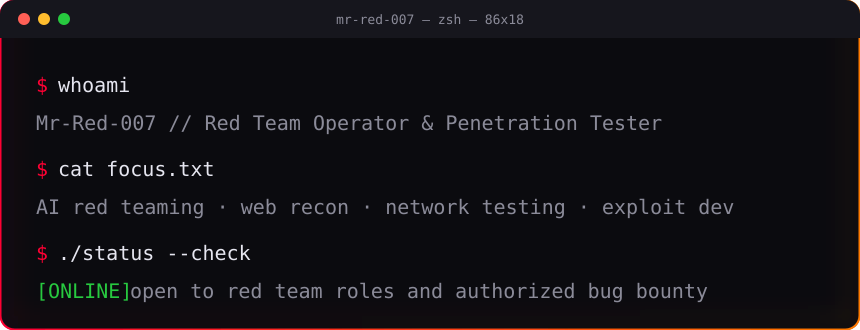

<div align="center">



<br/>

[](https://git.io/typing-svg)

</div>

---

```bash
$ cat about.md
```

I break systems on paper and with permission so the people who run them can fix them first. My work spans network testing, web application security, and AI and LLM red teaming.

| Signal | Value |
|---|---|
| 🏆 TryHackMe | Top 5% |
| 🧪 Hack The Box | Skilled |
| 🤖 AI red team scenarios | 20+ |
| 🔎 Critical findings reported | 15+ |
| 🎤 CTF events hosted | 3 (150+ players) |

---

```bash
$ ls projects/        # auto-synced daily from public repos
```

<!-- PROJECTS:START -->
| Project | What it does |
|---|---|
| [**arcsheet**](https://github.com/Mr-Red-007/arcsheet) | Aircrack-ng workflow in one bash CLI: monitor mode, scanning, handshake capture, cracking. |
| [**profile**](https://github.com/Mr-Red-007/profile) | Linux power, temperature, and GPU control from one command. |
| [**ctf-bug-bounty-enum-**](https://github.com/Mr-Red-007/ctf-bug-bounty-enum-) | Enumeration toolkit with web and OS checks, plus a web security cheatsheet. |
| [**CVE-2026-27739-POC**](https://github.com/Mr-Red-007/CVE-2026-27739-POC) | Proof of concept for CVE-2026-27739. |
<!-- PROJECTS:END -->

---

```bash
$ cat domains.txt
```

<div align="center">

</div>

---

```bash
$ cat skills.txt
```

**AI security:** AI red teaming · prompt injection · jailbreak testing · adversarial ML · OWASP LLM Top 10
**Offensive:** penetration testing · vulnerability assessment · exploit development · SSRF · STRIDE
**Defensive:** WAF deployment · vulnerability scanning · remediation planning · threat modeling
**Forensics:** post-exploitation analysis · log and configuration review
**Networking:** TCP/IP · DNS · DHCP · HTTP/S · network troubleshooting
**Systems:** Linux · Bash · Python automation · OS security checks
**Tools:** Burp Suite · Nmap · Nessus · Qualys · FFUF · Gobuster


---

```bash
$ cat certs.txt
```

- Certified Ethical Hacker: EC-Council, 2024
- Certified Network Engineer: IPv6 Forum, 2025

---

```bash
$ cat ethics.txt
```

Testing happens only with written permission. Findings go to the owner first, with time to fix before anything is published.

<div align="center">

📫 Contact: use the email on my GitHub profile or open an issue on any repo.

</div>
