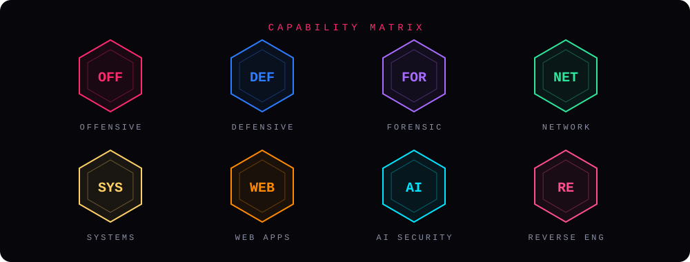

 

 

### ▸ 01 — ABOUT

I test systems with permission so the people who run them can fix problems first. My work covers network security, web application testing, and AI and LLM red teaming.

  
  
  
  
  

### ▸ 02 — CAPABILITY MATRIX

  

### ▸ 03 — OPERATIONS  *(auto-updated every 6 hours)*

<!-- PROJECTS:START -->

  

No public projects yet.

<!-- PROJECTS:END -->

### ▸ 04 — ARSENAL

| Domain | Capabilities |
|---|---|
| **Offensive** | Penetration testing · vulnerability assessment · exploit development · SSRF |
| **Defensive** | WAF deployment · vulnerability scanning · remediation planning · STRIDE threat modeling |
| **Forensic** | Post-exploitation analysis · log and configuration review |
| **Network** | TCP/IP · DNS · DHCP · HTTP/S · Nmap · Wireshark · troubleshooting |
| **Systems** | Linux · Bash · Python automation · OS security checks |
| **AI security** | Prompt injection · jailbreak testing · adversarial ML · OWASP LLM Top 10 |

  
  
  
  
  
  

### ▸ 05 — CREDENTIALS

- **Certified Ethical Hacker**: EC-Council, 2024
- **Certified Network Engineer**: IPv6 Forum, 2025

### ▸ 06 — TELEMETRY

  
  

### ▸ 07 — RULES OF ENGAGEMENT

Testing happens only with written permission. Findings go to the owner first, with time to fix before anything is published.

 

`// end of transmission · contact via the email on my GitHub profile or an issue on any repo`

